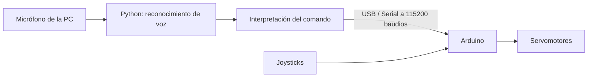

# Brazo robótico controlado por voz

Proyecto de robótica: control de un brazo de **4 articulaciones** mediante **comandos de voz desde una PC**, con comunicación USB/Serial hacia Arduino. También conserva el **control manual por joysticks**.

## ¿Cómo funciona?



1. Se presiona **Enter** en la terminal y se dicta una instrucción.
2. Python graba **3 segundos** de audio y transcribe la frase con `SpeechRecognition` y el servicio de reconocimiento de Google (requiere Internet).
3. El programa identifica la articulación y la dirección, y envía un comando corto por Serial.
4. Arduino valida el comando, aplica los límites configurados y mueve el servo correspondiente.
5. Arduino devuelve una confirmación que Python muestra en pantalla.

> **Alcance actual:** se controlan posiciones angulares ordenadas a servos convencionales. No hay medición de posición real, visión por computadora ni control de trayectoria del extremo del brazo.

## Funcionalidades

- Control de **base, hombro y codo** con desplazamientos incrementales de **15° por orden de voz**.
- **Apertura y cierre** de la pinza mediante dos comandos independientes.
- Control manual simultáneamente disponible con **cuatro ejes de joystick**.
- Restricciones de ángulos por articulación para evitar exceder los límites configurados.
- Respuestas por Serial para confirmar comandos válidos o informar errores.
- `detach()` automático de servos tras **1 segundo sin órdenes ni movimiento manual**.

## Hardware

- Placa Arduino compatible con la librería `Servo.h` y con los pines indicados.
- Cuatro servomotores: base, hombro, codo y pinza.
- Joysticks o entradas analógicas de control manual.
- Brazo mecánico y cable USB de datos para conectar Arduino con la PC.
- Micrófono conectado a la PC.
- **Fuente adecuada para los servomotores** (según tensión y corriente de los modelos utilizados).

### Conexiones definidas en el código de Arduino

| Elemento | Pin Arduino |
|---|---|
| Servo de la base | D11 |
| Servo del hombro | D9 |
| Servo del codo | D10 |
| Servo de la pinza | D6 |
| LED/testigo | D3 |
| Joystick — base | A0 |
| Joystick — hombro | A1 |
| Joystick — codo | A2 |
| Joystick — pinza | A3 |

**Importante:** no alimentar los cuatro servos directamente desde el pin de 5 V del Arduino ni depender del USB de la PC para su corriente. Usar una fuente apropiada para los servos y **conectar la masa (GND) de esa fuente con GND de Arduino**. Comprobar tensión, polaridad y corriente antes de encender.

## Software

- Arduino IDE y librería estándar **Servo** (`#include <Servo.h>`).
- Python 3 y los paquetes `SpeechRecognition`, `sounddevice`, `numpy` y `pyserial`.
- Conexión a Internet para el reconocimiento de voz mediante Google.

### Estructura sugerida

```text
brazo-robotico-voz/
├── README.md
├── brazo_robotico.ino    # Firmware de Arduino
└── voz.py               # Reconocimiento de voz y envío Serial
```

> Si los archivos tienen otros nombres, adaptá esta estructura a tu repositorio.

## Instalación y ejecución

### 1. Cargar el firmware en Arduino

1. Abrir `brazo_robotico.ino` en Arduino IDE.
2. Seleccionar la placa y el puerto que corresponda.
3. Cargar el programa y comprobar que no haya errores de compilación.
4. Para probar comandos sin Python, abrir el Monitor Serie a **115200 baudios**, seleccionar terminación **Nueva línea** y enviar, por ejemplo, `BASE,IZQUIERDA`.
5. **Cerrar el Monitor Serie** antes de ejecutar Python: los dos programas no deben intentar abrir simultáneamente el mismo puerto.

### 2. Preparar Python

Desde una terminal ubicada en la carpeta del proyecto:

```bash
python -m pip install SpeechRecognition sounddevice numpy pyserial
```

En `voz.py`, verificar la configuración:

```python
PUERTO_ARDUINO = "COM3"
BAUDRATE = 115200
FS = 16000
DURACION = 3
```

`COM3` es el puerto utilizado en la configuración actual de Windows; si cambia el puerto del Arduino, hay que modificarlo aquí. La velocidad debe coincidir con `Serial.begin(115200)`.

### 3. Iniciar el control por voz

```bash
python voz.py
```

Cuando aparezca `Presiona ENTER para hablar...`, presionar Enter y decir **una orden** durante los tres segundos de grabación.

**Ejemplo de salida:**

```text
✅ Arduino conectado en COM3
🎙️ Control por voz iniciado

Presiona ENTER para hablar...
🎤 Habla ahora...
📝 Reconocido: mover base izquierda
🤖 Comando detectado: BASE,IZQUIERDA
📤 Enviado: BASE,IZQUIERDA
📥 Arduino: Nuevo angulo: 100
📥 Arduino: OK: BASE,IZQUIERDA
```

La salida de ángulos depende de la posición actual; `100` es un ejemplo.

Para salir de Python, presionar `Ctrl+C`.

## Comandos disponibles

| Frase de voz | Comando Serial | Comportamiento |
|---|---|---|
| «Mover base izquierda» | `BASE,IZQUIERDA` | Giro incremental de 15° |
| «Mover base derecha» | `BASE,DERECHA` | Giro incremental de 15° |
| «Mover hombro arriba» | `HOMBRO,ARRIBA` | Movimiento incremental de 15° |
| «Mover hombro abajo» | `HOMBRO,ABAJO` | Movimiento incremental de 15° |
| «Mover codo arriba» | `CODO,ARRIBA` | Movimiento incremental de 15° |
| «Mover codo abajo» | `CODO,ABAJO` | Movimiento incremental de 15° |
| «Abrir pinza» | `PINZA,ABRIR` | Va a la posición configurada como abierta |
| «Cerrar pinza» | `PINZA,CERRAR` | Va a la posición configurada como cerrada |

El parser acepta algunas variaciones, como «subir hombro» o «cerrar la pinza». No permite todas las direcciones en todas las articulaciones: la base gira horizontalmente, y hombro y codo se mueven arriba/abajo.

### Protocolo Serial

Los mensajes son texto UTF-8 terminado en salto de línea (`\n`):

```text
HOMBRO,ARRIBA\n
PINZA,CERRAR\n
```

Arduino contesta con `OK: <comando>` si reconoce la instrucción, o `ERROR: ...` si el comando es desconocido. Puede emitir también el nuevo ángulo ordenado.

## Configuración de movimientos en Arduino

### Paso por voz y control manual

```cpp
const int voiceStep = 15;    // Grados por orden de voz
const int stepPerTick = 1;   // Grados por iteración con joystick
const int movementDelay = 10; // Milisegundos entre iteraciones
```

El movimiento por voz **es relativo a la posición guardada**; dos órdenes consecutivas suman dos pasos, siempre respetando los límites. Una orden no especifica un ángulo absoluto.

### Límites configurados

| Articulación | Mínimo | Máximo | Posición inicial interna |
|---|---:|---:|---:|
| Base | 0° | 170° | 85° |
| Hombro | 115° | 180° | 115° |
| Codo | 0° | 130° | 0° |
| Pinza | 130° | 180° | 130° |

En la configuración actual de la **pinza invertida**:

```cpp
const int gripperOpenAngle = 180;
const int gripperClosedAngle = 130;
```

Los sentidos de base, hombro y codo se adaptan mediante `invertBase`, `invertShoulder` e `invertElbow`. Si una dirección se mueve al revés de lo esperado, revisar la inversión del eje correspondiente **después de verificar la mecánica**.

> Estos límites pertenecen al prototipo actual. No son valores universales: deben comprobarse con el montaje real para evitar esfuerzos contra topes físicos.

## Seguridad y limitaciones

- **Primero probar sin carga.** La pinza abre/cierra directamente hacia posiciones extremas configuradas; verificar que no produzca golpes o esfuerzos mecánicos.
- **No hay realimentación de posición.** Un paso de 15° es un cambio en el ángulo ordenado al servo, no una garantía de 15° reales en la articulación; hay holguras, carga y tolerancias.
- El `detach()` deja de enviar pulsos de control después de un segundo. En articulaciones con carga, **se puede perder la posición** y, al reconectar, el servo puede intentar volver bruscamente al último valor guardado. Si el brazo debe sostener peso, revisar esta decisión antes de operar.
- Evitar mover un joystick mientras se da una orden de voz: ambos controles pueden actuar sobre el mismo eje.
- El reconocedor graba durante un intervalo fijo y **requiere Internet**. Es posible que no interprete correctamente frases en ambientes ruidosos; conviene emitir una orden por vez.
- No hay botón de parada de emergencia implementado por software. Mantener acceso a un medio de corte de alimentación de actuadores durante las pruebas.

## Solución de problemas

| Problema | Qué revisar |
|---|---|
| `could not open port 'COM3'` | Puerto correcto, cable USB y Monitor Serie cerrado. |
| Python reconoce la orden, pero el brazo no se mueve | Baudrate `115200`, comunicación USB, alimentación externa, masa compartida y límites del servo. |
| `No pude entenderte` | Micrófono predeterminado, ruido y duración de grabación. |
| Error de reconocimiento de Google | Conexión a Internet. |
| Se mueve en sentido contrario | `invertBase`, `invertShoulder`, `invertElbow` o posiciones abierta/cerrada de pinza. |
| El servo vibra, pierde fuerza o se reinicia Arduino | Alimentación insuficiente, cables, corriente o esfuerzos mecánicos. |
| El servo vuelve bruscamente al moverse | Efectos del `detach()`/`attach()` y posible desplazamiento físico mientras estaba desconectado. |